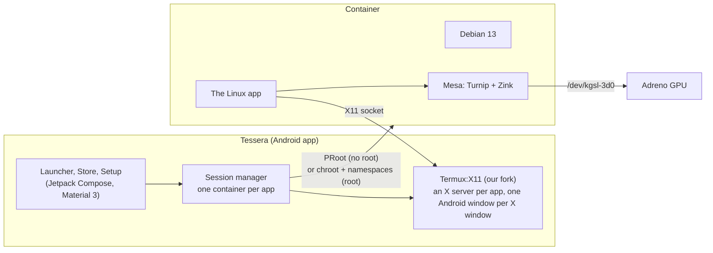

<div align="center">


# Tessera

### Linux apps on Android, as easy as installing an app.

Firefox, GIMP, VS Code, LibreOffice and the rest of Debian on your phone, each with its own icon,
its own window and its own card in Recents. No terminal setup, no VNC, no guides to follow.

[](https://github.com/daryan044/tessera-linux/actions/workflows/build.yml)
[](LICENSE)


</div>

---

## Why Tessera

Running Linux on a phone has always meant a terminal app, a pile of commands from a forum post,
a VNC viewer showing a whole desktop shrunk to a phone screen, and starting over when something
breaks. Tessera turns all of that into an app launcher:

1. **Open Tessera and tap Install.** It downloads Debian 13 (digest-verified) and sets it up.
2. **Pick apps from the Store.** Debian's catalog of nearly 2,000 desktop apps, with icons,
   categories and search. Installs run in the background.
3. **Tap an app.** It opens in its own window, like any Android app.

That's it. Everything below happens on its own.

## What makes it different

### 🪟 Every Linux app is a real Android app
- Each app gets **its own window** and **its own card in Recents**, named and with its icon;
  swipe it away to close it.
- Apps that open several windows (a browser's second window, a settings dialog) get **a Recents
  card per window**.
- **Pin Linux apps to your phone's home screen** next to your Android apps.
- No desktop to drive inside a tiny VNC picture: the app fills the screen, at a readable size.

### ⌨️ Feels native, not emulated
- **The Android keyboard opens by itself** when you tap into a text field in a Linux app, and
  hides when you leave it. Tessera listens to the app's accessibility events to know.
- **Clipboard works both ways** between Linux and Android apps.
- **Sound** plays through Android, per app.
- **Touch is touch:** scroll and pinch in Firefox with your fingers, or switch an app to touchpad
  or mouse mode from its side menu.
- A side menu on every window (swipe from the edge) has what a phone lacks: right click, Esc,
  Tab, Ctrl+C, Alt+Tab, F11.

### 🚀 Real GPU acceleration on Snapdragon phones
- Tessera ships its own build of Mesa: **Turnip** (Vulkan for Adreno GPUs, talking to Android's
  own GPU driver interface) and **Zink** (OpenGL on top of it). Apps get **OpenGL 4.6 and
  Vulkan** with no setup; on an Adreno 740, glxgears runs at ~240 fps.
- **Graphics fixes per app:** hold an app's icon to switch its GPU off or turn on workarounds for
  driver bugs, named after what you see ("Fix black blocks", "Fix flicker").

### 🔒 Every app in its own sandbox
- Each app runs in a container that gets **only what it's granted**: specific folders (read-only
  or not), network, sound, a display, devices. Change any of it from the app's page.
- Two engines, and the app tells you honestly which permissions each one can enforce:
  - **PRoot mode** works on any phone, no root. Its limits are best-effort.
  - **Chroot mode** (Magisk, KernelSU or APatch) enforces every permission with kernel
    namespaces and an unprivileged user, and runs faster.

### 📺 Cast to a TV, use the phone as the trackpad *(new)*
- Send an app to a TV or monitor, by cable or wireless display, at a resolution that suits it.
- The phone becomes a **Material 3 trackpad**: move, tap to click, tap-and-hold to drag, two
  fingers to scroll or right-click, with a dot field that lights up under your fingers. The
  keyboard still pops up by itself for text fields.

### 🔌 USB devices without root *(new, experimental)*
- Give an app a USB device, and Tessera asks Android's permission and hands it over at launch.
  Inside, apps use it through libusb as usual, even in PRoot mode, where Android normally keeps
  apps away from USB entirely.

### 🧰 And everything around it
- **Terminal** for command-line apps, with extra keys and pinch to zoom.
- **Shortcuts:** your own commands as icons, in a terminal or a window, optionally as root.
  Comes with Claude Code, which installs itself on first run.
- **Apps installed any way show up:** apt in a terminal, a downloaded .deb, all listed.
- **Config editor** for .bashrc, apt sources, hosts and more, without a terminal.
- **Keeps running in the background:** a foreground service holds sessions, and Setup lifts
  Android's background process limit in one tap (with root) or shows the adb command.
- **Material 3 Expressive** design with dynamic colors, blur and your own tabs, pins and
  favorites.
- **Help that knows how Tessera works:** an intro on first run, and when an app misbehaves, the
  Claude Code shortcut is handed Tessera's architecture, its known failure modes and the output of
  the apps that just closed — a container can't read Android's log, so Tessera reaches it in.
  Setup → **Copy diagnostics** puts the same thing on your clipboard for any other assistant. A bug
  report is drafted for you; posting it stays your decision.

## Getting started

**Requirements:** Android 7 or newer, an arm64 phone (32-bit ARM and x86_64 builds exist but are
untested), a few GB of free storage. GPU acceleration needs a Snapdragon (Adreno) GPU. Root is
optional.

1. Download the APK. The first release is on its way; until then, take the APK from the latest
   successful [build](https://github.com/daryan044/tessera-linux/actions/workflows/build.yml)
   or build it yourself (below).
2. Open Tessera, go to **Setup** and install Debian. Allow it to lift the background process
   limit when asked, so Android doesn't stop your apps.
3. Open the **Store**, install an app, and tap it.

Tessera can't be on Google Play: it targets Android 9's API level on purpose, because newer levels
forbid running programs from app storage, which is where Linux lives (the same trade-off Termux
makes).

## Status

| Area | State |
|---|---|
| Debian install, terminal, background service | ✅ Works |
| GUI apps in their own windows, a Recents card per window | ✅ Works |
| Sound, clipboard both ways, automatic keyboard | ✅ Works |
| Firefox, VS Code, HandBrake | ✅ Work, with GPU acceleration |
| Store, installs, apps installed with apt or .deb | ✅ Works |
| GPU acceleration (Turnip + Zink) in PRoot mode | ✅ Works on Adreno 740 |
| Chroot mode with root | ✅ Works; GPU in chroot mode is new |
| Casting to a TV with the phone as trackpad | 🧪 New |
| USB devices for PRoot apps | 🧪 Experimental |
| Store screenshots (from Flathub) | 🧪 New |

Full detail, item by item: [docs/ROADMAP.md](docs/ROADMAP.md).

## How it works



- **Containers:** PRoot is built from source for Android and ships inside the APK; chroot mode
  uses a private mount namespace (and a network namespace when network isn't granted), a minimal
  /dev and an unprivileged user.
- **Display:** each app gets its own X server and display, so apps can't see each other's
  windows. A small window manager keeps the app fullscreen; Tessera follows its windows to give
  each its own Android task.
- **Graphics:** frames from Zink reach the X server as images (Kopper and Vulkan's software
  presentation path), since Android offers no shared-buffer path for them.
- **Permissions** come from per-app manifests ([below](#app-manifests)), changed by the user in
  the app and stored apart from them.

## App manifests

Each launcher entry is a manifest: what to run, and what it may touch.

```json
{
  "id": "gimp",
  "name": "GIMP",
  "category": "Graphics",
  "gui": true,
  "exec": ["/usr/bin/gimp"],
  "permissions": {
    "display": true,
    "network": false,
    "devices": ["/dev/dri/renderD128"],
    "filesystem": [
      { "path": "/storage/emulated/0/Pictures", "mountAt": "/home/user/Pictures", "readOnly": false }
    ]
  }
}
```

Store installs write these for you from each app's desktop file, with permissions that suit its
category.

## Building

JDK 17 and the Android SDK with NDK 28.2.13676358 and CMake 3.31.6.

```
git submodule update --init           # Termux:X11 fork (third_party/termux-x11)
scripts/proot/build.sh                # once: builds PRoot into app/src/main/jniLibs
scripts/x11/build-native.sh           # once, on Linux or WSL: X server + xkb data into build/x11
sudo scripts/gpu/build-mesa.sh        # optional, on Linux or WSL: the GPU driver
sudo scripts/usb/build-usb.sh         # optional, on Linux or WSL: the USB bridge
./gradlew assembleDebug testDebugUnitTest
```

The native builds need a Linux host (WSL is fine); the app itself builds on Windows, macOS or
Linux. Builds without the optional parts simply lack GPU acceleration or the USB bridge. More on
the native pieces: [docs/native-binaries.md](docs/native-binaries.md).

Release builds (`./gradlew assembleRelease`) are signed with the key in `keystore.properties`
at the top of the project (`storeFile`, `storePassword`, `keyAlias`, `keyPassword`; never
committed), or the `TESSERA_KEYSTORE*` environment variables; without either, with the debug key.
GitHub Actions ([build.yml](.github/workflows/build.yml)) builds everything from source on each
push, and publishes a release for each `v*` tag, signed when the `TESSERA_KEYSTORE_BASE64`,
`TESSERA_KEYSTORE_PASSWORD`, `TESSERA_KEY_ALIAS` and `TESSERA_KEY_PASSWORD` secrets are set.

## FAQ

**Do I need root?** No. Everything works in PRoot mode. Root adds chroot mode, which enforces
permissions properly and runs faster.

**Which apps work?** Desktop apps from Debian's catalog, and anything you install with apt or as a
.deb for arm64. Electron apps like VS Code work.

**Why isn't it on Google Play?** Play requires a newer target API level, and those forbid running
programs from app storage, which is what Linux needs. F-Droid has no such rule.

**My apps stop in the background.** Android 12 and newer limit background processes. Setup shows
whether the limit is on, and lifts it in one tap with root, or gives you the adb command.

**An app draws wrong with the GPU on.** Hold its icon, open Graphics fixes, and try the fix that
matches what you see, or switch its GPU off.

**An app won't start and I can't tell why.** The error is usually in Android's log, which a
container can't read, so Tessera keeps the output of recently closed apps next to notes on how it
all works. Open the Claude Code shortcut, which reads both, or use Setup → Copy diagnostics and
paste it into any AI. Turn it off in Setup if you'd rather nothing were kept; the files never leave
the phone on their own, and they do name your apps and folders.

## License

Copyright (C) 2026 Daryan Kamaran Karim

This program is free software: you can redistribute it and/or modify it under the terms of the
GNU General Public License as published by the Free Software Foundation, either version 3 of the
License, or (at your option) any later version. See [LICENSE](LICENSE).

It is distributed in the hope that it will be useful, but WITHOUT ANY WARRANTY; without even the
implied warranty of MERCHANTABILITY or FITNESS FOR A PARTICULAR PURPOSE.

### Third-party components

| Component | License | Used for |
|---|---|---|
| [PRoot](https://github.com/termux/proot) (Termux fork) | GPL-2.0-or-later | container engine, built by `scripts/proot/build.sh` |
| [talloc](https://talloc.samba.org) | LGPL-3.0-or-later | PRoot dependency (`scripts/proot/talloc-compat.c` is adapted from Samba) |
| [Termux:X11](https://github.com/termux/termux-x11) ([our fork](https://github.com/daryan044/termux-x11)) | GPL-3.0 | X server and GUI windows |
| [Mesa](https://mesa3d.org) | MIT | GPU driver (Turnip, Zink), built by `scripts/gpu/build-mesa.sh` |
| [libusb](https://libusb.info) | LGPL-2.1-or-later | USB for PRoot apps, built by `scripts/usb/build-usb.sh` |
| [Termux terminal-emulator / terminal-view](https://github.com/termux/termux-app) | Apache-2.0 | terminal |
| [Haze](https://github.com/chrisbanes/haze) | Apache-2.0 | background blur |
| AndroidX, Jetpack Compose, Material 3 | Apache-2.0 | UI |
| kotlinx.serialization | Apache-2.0 | manifests |
