<div align="center">

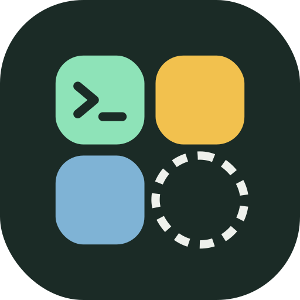

# Tessera

### A real Linux desktop's apps on your phone. As easy as installing an app.

Firefox, GIMP, VS Code, LibreOffice, all of Debian **and Flathub** on Android, each with its own
icon, its own window and its own card in Recents, running on the phone's GPU and wearing the
phone's own colors. No terminal setup, no VNC, no guides to follow.

[](https://github.com/daryan044/tessera-linux/actions/workflows/build.yml)
[](LICENSE)


**[⬇ Download Tessera 0.5.0 (alpha)](https://github.com/daryan044/tessera-linux/releases/download/v0.5.0/tessera-v0.5.0.apk)**
· [▶ 1-minute demo video](https://github.com/daryan044/tessera-linux/releases/download/v0.4.0/tessera-demo.mp4)
· [All releases](https://github.com/daryan044/tessera-linux/releases)

[](https://apps.obtainium.imranr.dev/redirect?r=obtainium://add/https://github.com/daryan044/tessera-linux)

</div>

---

<table>
<tr>
<td width="33%" valign="top">

**📦 Flathub on Android**<br>
2,800+ Flathub apps in a phone app store. No root, no bubblewrap, no user namespaces needed, and
still on the GPU.

</td>
<td width="33%" valign="top">

**🎨 Material You for Linux**<br>
GTK, libadwaita, Qt, LibreOffice and Firefox take your wallpaper's colors and follow dark mode,
**live**, no restart.

</td>
<td width="33%" valign="top">

**🚀 Desktop-class GPU**<br>
OpenGL 4.6 and Vulkan on Adreno through our own Turnip + Zink build. glxgears at ~240 fps.

</td>
</tr>
<tr>
<td valign="top">

**🪟 One app, one Android app**<br>
Every Linux app and every one of its windows gets its own Recents card. Pin them to your home
screen.

</td>
<td valign="top">

**🔒 A sandbox per app**<br>
Folders, network, sound, USB, root: granted one by one, enforced by the kernel in chroot mode.

</td>
<td valign="top">

**🖱️ Your phone as a PC trackpad**<br>
Pair it with a computer over Bluetooth (or USB, with root) and it's a trackpad and keyboard. Or
cast Linux apps to a TV.

</td>
</tr>
<tr>
<td valign="top">

**🖥️ A desktop, too** *(new)*<br>
One tap for a whole Linux desktop: windows you move and snap, a Material dock and Start menu,
your wallpaper and colors.

</td>
<td valign="top">

**🔍 Find any app**<br>
Android's own search pill on top of your Linux apps, with full-screen results as you type.

</td>
<td valign="top">

**📁 Files and tasks**<br>
A file manager across Android and Linux, and a task manager with live CPU and memory per app.

</td>
</tr>
</table>

## Screenshots

<table>
<tr>
<td align="center" width="25%">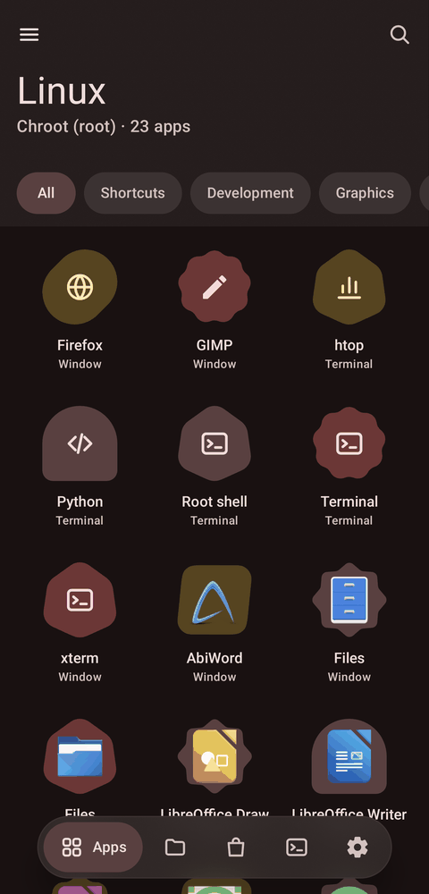<br><sub>Your Linux apps, with search and the desktop</sub></td>
<td align="center" width="25%">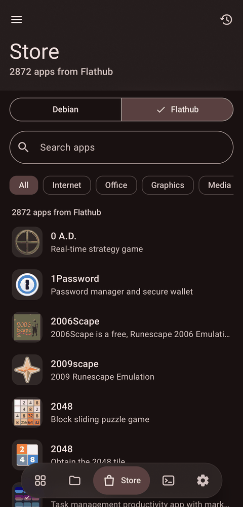<br><sub>Debian or Flathub, one switch</sub></td>
<td align="center" width="25%">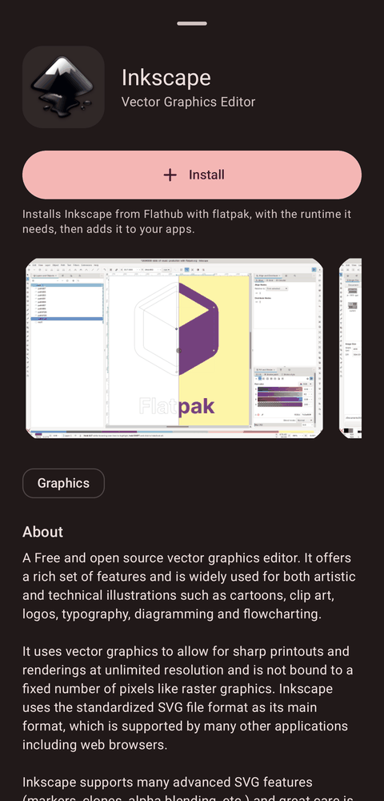<br><sub>Flathub apps, one tap to install</sub></td>
<td align="center" width="25%">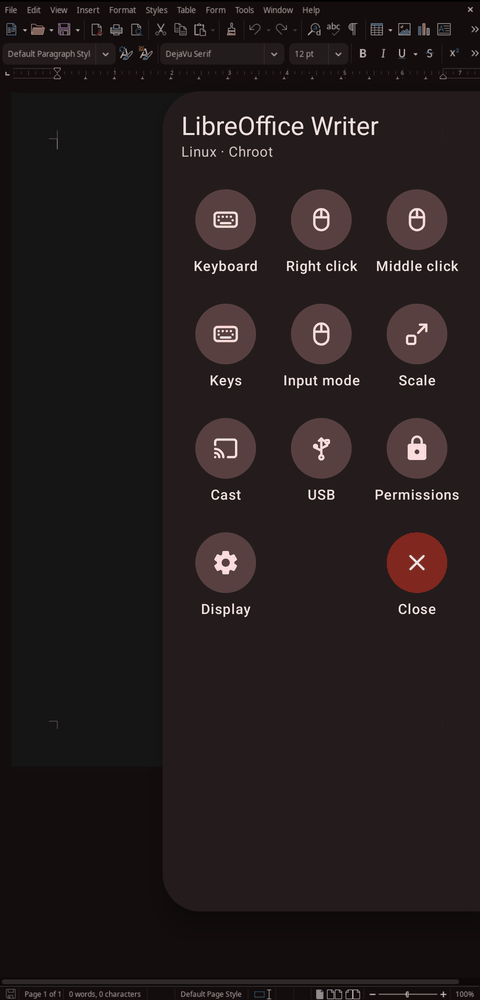<br><sub>The window panel over LibreOffice</sub></td>
</tr>
<tr>
<td align="center" width="25%">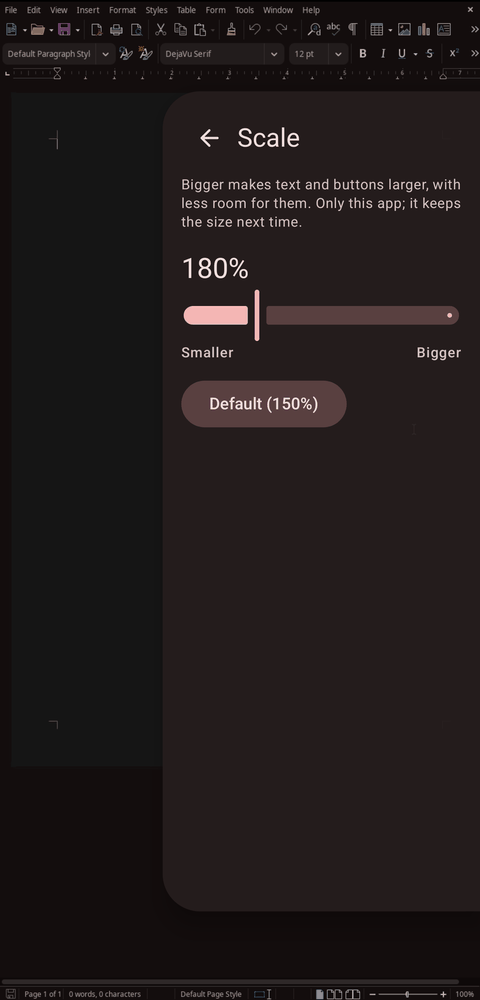<br><sub>Live scaling, kept per app</sub></td>
<td align="center" width="25%">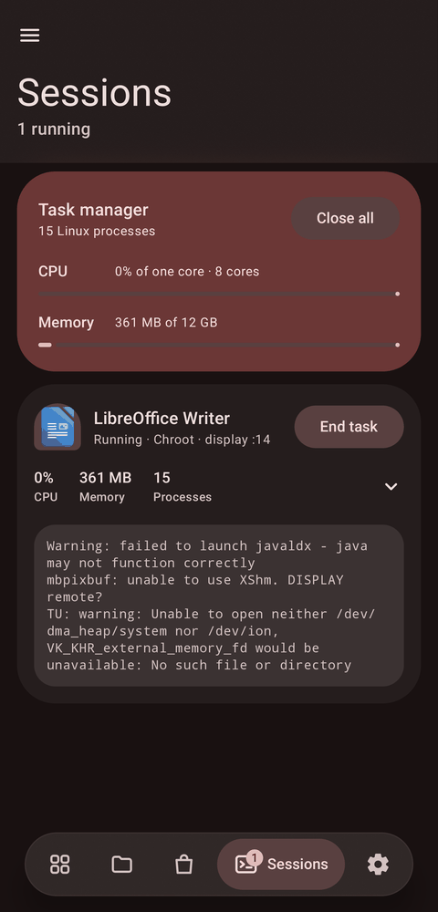<br><sub>Task manager and Sessions</sub></td>
<td align="center" width="25%">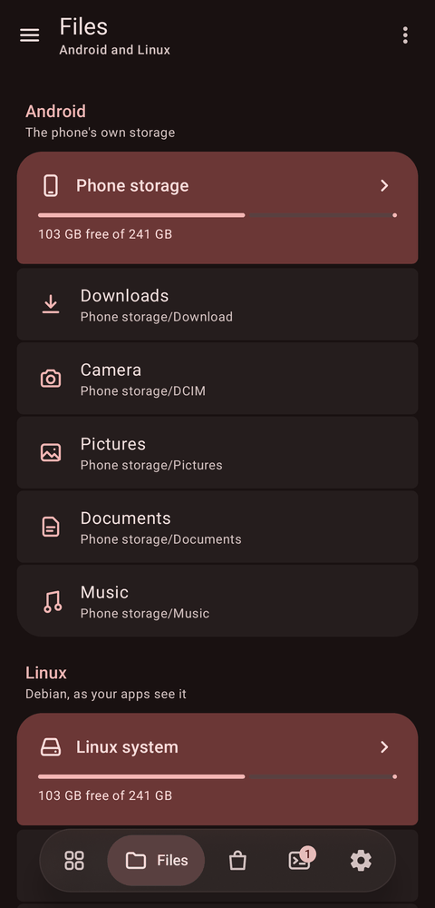<br><sub>Files: Android and Linux</sub></td>
<td align="center" width="25%">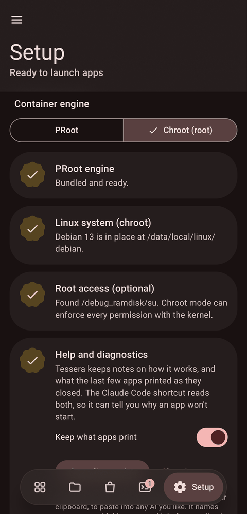<br><sub>Setup: PRoot or chroot</sub></td>
</tr>
</table>

**The desktop** *(new in 0.2)*: windows in your phone's colors, a dock and Start menu, icons on the
desktop, Flathub apps too.

<table>
<tr>
<td align="center" width="25%">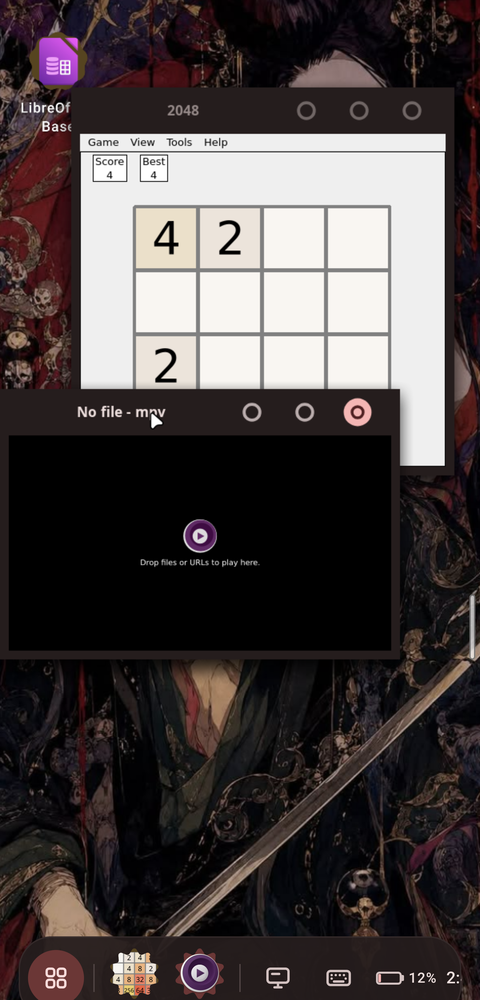<br><sub>Windows side by side (mpv from Flathub)</sub></td>
<td align="center" width="25%">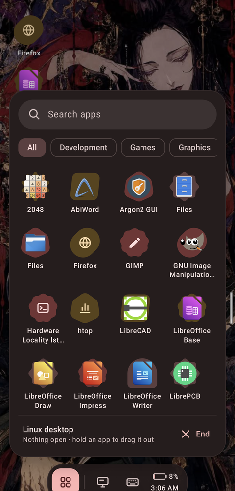<br><sub>The Start menu</sub></td>
<td align="center" width="25%">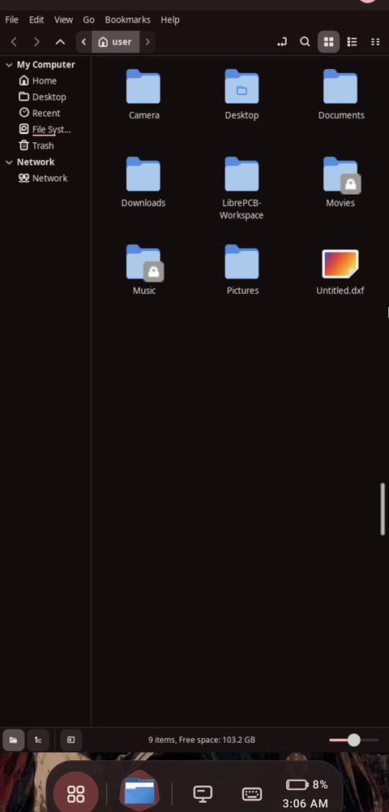<br><sub>Too big for the phone? Maximized</sub></td>
<td align="center" width="25%">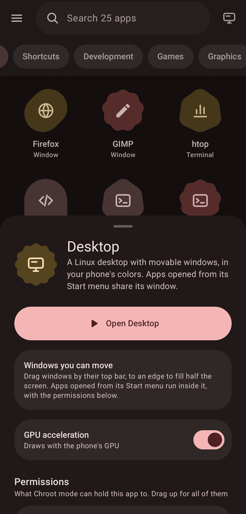<br><sub>Opens like any app</sub></td>
</tr>
</table>

**Your phone's theme, on Linux apps.** The same apps in dark mode, before and after Tessera's
theming (GTK 3's Nemo and LibreOffice Impress):

<table>
<tr>
<td align="center" width="25%">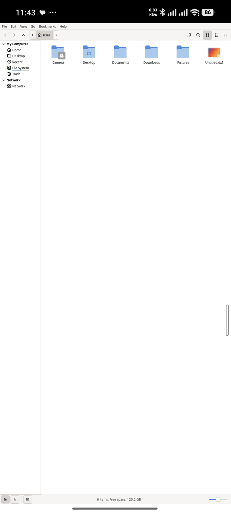<br><sub>Nemo, before</sub></td>
<td align="center" width="25%">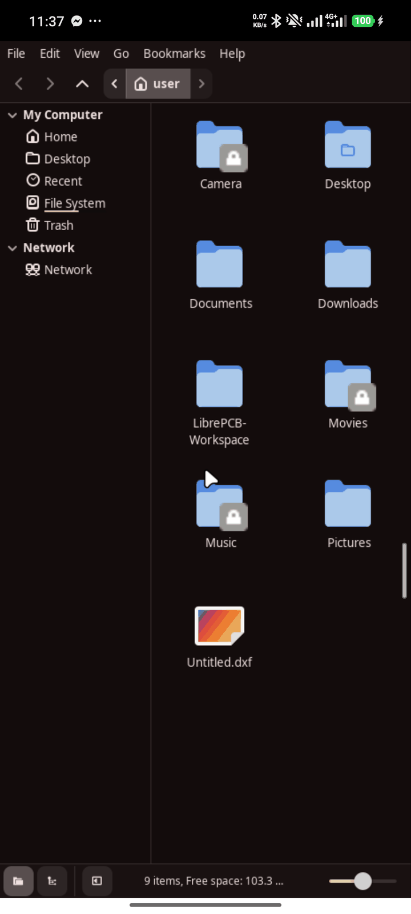<br><sub>Nemo, themed</sub></td>
<td align="center" width="25%">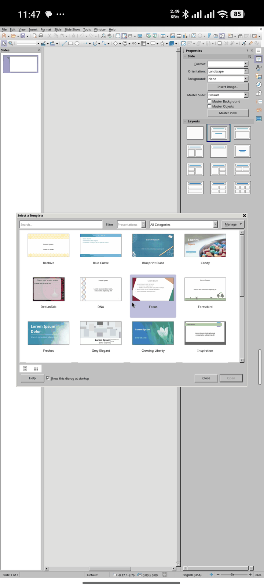<br><sub>Impress, before</sub></td>
<td align="center" width="25%">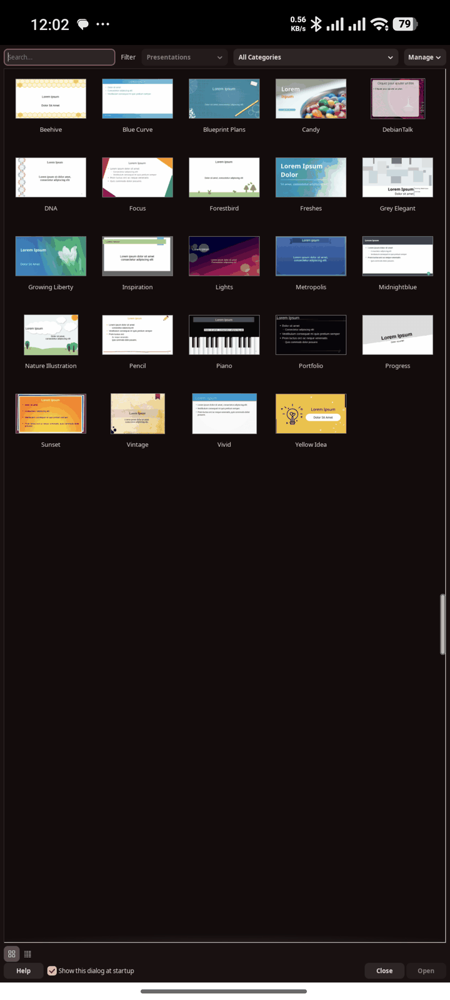<br><sub>Impress, themed</sub></td>
</tr>
</table>

## Why Tessera

Running Linux on a phone has always meant a terminal app, a pile of commands from a forum post,
a VNC viewer showing a whole desktop shrunk to a phone screen, and starting over when something
breaks. Tessera turns all of that into an app launcher:

1. **Open Tessera and tap Install.** It downloads Debian 13 (digest-verified) and sets it up.
2. **Pick apps from the Store.** Debian's catalog of nearly 2,000 desktop apps, and with one tap
   **Flathub's 2,800+**, with icons, screenshots, categories and search. Installs run in the
   background.
3. **Tap an app.** It opens in its own window, like any Android app.

That's it. Everything below happens on its own.

## What makes it different

### 🐚 A full Linux shell, like Termux *(and AnLinux and Andronix in one)*
Tessera isn't only for windowed apps. Its **Terminal** is a complete Linux shell on your phone,
the way people use Termux: `apt install` anything from Debian's ~60,000 packages, `ssh` into
servers, `git`, `python`, `node`, `gcc`, `rust`, `vim`, `tmux`, `htop`, run servers and scripts,
compile code. **Root shell** gives you the same as root.

AnLinux and Andronix give you a full distro by pasting scripts into Termux and then a VNC viewer
for anything graphical. Tessera does all of it from one app:

| | Termux | AnLinux / Andronix | Tessera |
|---|---|---|---|
| Terminal with a real shell | ✅ | via Termux | ✅ built in, extra keys, pinch to zoom |
| Full Linux distro (Debian, glibc) | ❌ its own package set | ✅ by script, in PRoot | ✅ one tap, PRoot **or chroot** |
| No root needed | ✅ | ✅ | ✅ |
| Real chroot with root, kernel-enforced sandboxes | ❌ | partly | ✅ |
| GUI apps | X11 add-on | a whole desktop over VNC | ✅ each app in its own Android window |
| GPU acceleration | manual setup | ❌ | ✅ OpenGL 4.6 + Vulkan built in |
| Flathub apps | ❌ | ❌ | ✅ |
| App store, permissions per app | ❌ | ❌ | ✅ |

Anything you'd do in a Termux session or an Andronix distro, you can do in Tessera's terminal,
with the same Linux underneath. The one thing it doesn't copy is Termux's own add-ons, like
Termux:API's phone sensors and SMS commands.

### 📦 Flathub, on a phone, without root *(new)*
Flatpak normally needs **bubblewrap**, which needs **user namespaces**, which Android kernels don't
have. So `flatpak run` simply can't work on a phone. Tessera runs Flathub apps anyway:
- **Flatpak installs, Tessera runs.** `flatpak` downloads apps and runtimes as usual; Tessera then
  builds each app's world itself: the runtime mounted at `/usr`, the app at `/app`, the runtime's
  GL drivers where it expects them. In PRoot mode that's done with path translation, **no root
  at all**; in chroot mode with a private mount namespace.
- **Full integration, not a side door.** A Flathub app gets the same window, Recents cards,
  keyboard, sound, clipboard, theme and per-app permissions as every Debian app.
- **On the GPU.** Tessera's own Turnip driver loads inside Flathub's runtimes: OpenGL 4.6 on
  Adreno, confirmed with Flathub's mpv.
- **Optional, and one tap.** The Store switches between **Debian** and **Flathub**; the first
  time, one button installs flatpak and adds Flathub. 2,800+ arm64 apps, with screenshots.

### 🎨 Linux apps that look like Android apps *(new)*
Linux apps usually look like a 2010 desktop on a phone. Tessera themes them with **your phone's
Material You colors**, taken from your wallpaper, and **follows dark mode live**: flip Android to
dark and every open Linux app turns dark within seconds, no restart.
- **GTK 3** with a recolored adw-gtk3, **GTK 4 / libadwaita** through a settings portal Tessera
  serves itself, **Qt** through its GTK theme, **LibreOffice** on its modern GTK front end,
  **Firefox** and Chromium apps following light and dark.
- **A white, rounded pointer** (Bibata) instead of X's sharp black arrow, in every app.
- Theming is per app: hold any app for **Look and graphics** to leave it out.

### 🖥️ A whole desktop, when you want one *(new)*
The **desktop button** next to the search bar opens a Linux desktop, through the same sheet as any
app (install, permissions, graphics). Windows move, snap to half the screen and minimize, in the
style of addy-dclxvi's Circela xfwm4 theme redrawn in your phone's colors: title bars that match
the apps' own, ring buttons sized for fingers, your wallpaper behind it all. A floating Material
dock (a rail on the left in landscape) has the Start menu with search, a button per open window
(hold it to maximize, snap or close) and the clock. Apps opened from the Start menu run inside the
desktop, under its permissions. It runs xfwm4, installed the first time you open it.

### 🔍 Live scaling, per app *(new)*
Swipe in the window panel and drag **Scale**: the app re-lays out at the new size *while you
drag*, from tiny-and-dense to big-and-touchable, and remembers it for next time.

### 📁 A real file manager *(new)*
The **Files** tab browses phone storage and the whole Linux system side by side: copy, move,
compress, extract, edit text, change permissions, open files in Android or Linux apps, install a
.deb with a tap, or browse as root.

### 📊 Task manager *(new)*
Every Linux process, live CPU and memory per app, and **End task** with a two-tap "Sure?" right
on each app's card. It sees everything Tessera runs, its own X servers and root helpers included,
even ones left behind by an earlier run.

### 🪟 Every Linux app is a real Android app
- Each app gets **its own window** and **its own card in Recents**, named and with its icon;
  swipe it away to close it.
- Apps that open several windows (a browser's second window, a settings dialog) get **a Recents
  card per window**.
- **Pin Linux apps to your phone's home screen** next to your Android apps.
- No desktop to drive inside a tiny VNC picture: the app fills the screen, at a readable size.

### ⌨️ Feels native, not emulated
- **The Android keyboard opens by itself** when you tap into a text field in a Linux app, and
  hides when you leave it. Tessera listens to the app's accessibility events to know.
- **Clipboard works both ways** between Linux and Android apps.
- **Sound** plays through Android, per app.
- **Touch is touch:** scroll and pinch in Firefox with your fingers, or switch an app to touchpad
  or mouse mode from its side menu, where **touch and hold right-clicks**.
- A side menu on every window (swipe from the edge) has what a phone lacks: right click, Esc,
  Enter, Tab, Ctrl+C, Alt+Tab, F11.
- **Game controls** *(new)*: turn them on from a game's side menu for a thumb stick that holds
  WASD, a look area for mouse-look, and buttons that hold Fire, Run, Jump and Reload, so
  first-person games that expect a keyboard and mouse play by touch.

### 🚀 Real GPU acceleration on Snapdragon phones
- Tessera ships its own build of Mesa: **Turnip** (Vulkan for Adreno GPUs, talking to Android's
  own GPU driver interface) and **Zink** (OpenGL on top of it). Apps get **OpenGL 4.6 and
  Vulkan** with no setup; on an Adreno 740, glxgears runs at ~240 fps.
- **Graphics fixes per app:** hold an app's icon (**Look and graphics**) to switch its GPU off or
  turn on workarounds for driver bugs, named after what you see ("Fix black blocks", "Fix
  flicker").
- **Works for Flathub apps too:** the same driver loads inside Flathub's runtimes.

### 🔒 Every app in its own sandbox
- Each app runs in a container that gets **only what it's granted**: specific folders (read-only
  or not), network, sound, a display, devices. Change any of it from the app's page.
- Two engines, and the app tells you honestly which permissions each one can enforce:
  - **PRoot mode** works on any phone, no root. Its limits are best-effort.
  - **Chroot mode** (Magisk, KernelSU or APatch) enforces every permission with kernel
    namespaces and an unprivileged user, and runs faster.
  - **Droidspaces mode** *(new, experimental; root)* runs apps inside a container you made with
    [Droidspaces](https://github.com/ravindu644/Droidspaces-OSS), which you pick in Setup, with the
    same kernel-enforced permissions. See [docs/DROIDSPACES.md](docs/DROIDSPACES.md).

### 📺 Cast to a TV, use the phone as the trackpad *(new)*
- Send an app to a TV or monitor, by cable or wireless display, at a resolution that suits it.
- The phone becomes a **Material 3 trackpad**: move, tap to click, tap-and-hold to drag, two
  fingers to scroll or right-click, with a dot field that lights up under your fingers. The
  keyboard still pops up by itself for text fields.

### 🔌 USB devices, drives and flashing tools *(new, experimental)*
- Give an app a USB device, and Tessera asks Android's permission and hands it over at launch.
  Inside, apps use it through libusb as usual, even in PRoot mode, where Android normally keeps
  apps away from USB entirely.
- **All USB** for tools like fastboot, adb, heimdall and EDL: in chroot mode the bus is shared
  live, so a phone that reboots into fastboot under a new number is still there.
- **USB drives and SD cards** appear where Linux file managers look for them.

### 🖱️ The phone as a PC trackpad *(new)*
- Pair the phone with a computer over Bluetooth, or plug it in by USB (with root), and it becomes
  a **trackpad and keyboard** for that PC. No app needed on the computer.

### 🧰 And everything around it
- **Terminal** and **Root shell**: a full Linux shell, [like Termux](#-a-full-linux-shell-like-termux-and-anlinux-and-andronix-in-one),
  with extra keys and pinch to zoom.
- **Shortcuts:** your own commands as icons, in a terminal or a window, optionally as root.
  Comes with Claude Code, which installs itself on first run.
- **Apps installed any way show up:** apt in a terminal, a downloaded .deb, all listed.
- **Config editor** for .bashrc, apt sources, hosts and more, without a terminal.
- **Keeps running in the background:** a foreground service holds sessions, and Setup lifts
  Android's background process limit in one tap (with root) or shows the adb command.
- **Material 3 Expressive** design with dynamic colors, blur and your own tabs, pins and
  favorites.
- **Help that knows how Tessera works:** an intro on first run, and when an app misbehaves, the
  Claude Code shortcut is handed Tessera's architecture, its known failure modes and the output of
  the apps that just closed — a container can't read Android's log, so Tessera reaches it in.
  Setup → **Copy diagnostics** puts the same thing on your clipboard for any other assistant. A bug
  report is drafted for you; posting it stays your decision.

## Getting started

**Requirements:** Android 7 or newer, an arm64 phone (32-bit ARM and x86_64 builds exist but are
untested), a few GB of free storage. GPU acceleration needs a Snapdragon (Adreno) GPU. Root is
optional. Tested on a Xiaomi 13 Ultra and a Samsung Galaxy S26 Ultra, both on Android 16.

1. Download the APK: [tessera-v0.5.0.apk](https://github.com/daryan044/tessera-linux/releases/download/v0.5.0/tessera-v0.5.0.apk)
   (alpha; see the [releases](https://github.com/daryan044/tessera-linux/releases) for notes and
   newer versions), or build it yourself (below). With [Obtainium](https://github.com/ImranR98/Obtainium),
   add this repository's URL and it keeps Tessera up to date from its releases.
2. Open Tessera, go to **Setup** and install Debian. Allow it to lift the background process
   limit when asked, so Android doesn't stop your apps.
3. Open the **Store**, install an app, and tap it.

Tessera can't be on Google Play: it targets Android 9's API level on purpose, because newer levels
forbid running programs from app storage, which is where Linux lives (the same trade-off Termux
makes).

## Status

| Area | State |
|---|---|
| Debian install, terminal, background service | ✅ Works |
| GUI apps in their own windows, a Recents card per window | ✅ Works |
| Sound, clipboard both ways, automatic keyboard | ✅ Works |
| Firefox, VS Code, HandBrake | ✅ Work, with GPU acceleration |
| Store, installs, apps installed with apt or .deb | ✅ Works |
| GPU acceleration (Turnip + Zink) in PRoot mode | ✅ Works on Adreno 740 |
| Chroot mode with root | ✅ Works; GPU in chroot mode is new |
| Droidspaces mode (pick a Droidspaces container) | 🧪 New; no Flathub apps or phone adb yet |
| Flathub apps (install from the Store, launch, GPU) | ✅ Works in PRoot and chroot mode |
| Desktop (xfwm4, dock, Start menu, wallpaper) | 🧪 New; first runs on a Snapdragon 8 Gen 2 in chroot mode |
| Material You theming, live dark mode (GTK, libadwaita, Qt, LibreOffice, Firefox) | ✅ Works |
| Live per-app scaling, white pointer, window panel | ✅ Works |
| Files tab, task manager | 🧪 New |
| Game controls (stick, mouse-look, hold buttons) | 🧪 New; tested with AntWare from Flathub |
| Casting to a TV with the phone as trackpad | 🧪 New |
| The phone as a PC trackpad (USB, Bluetooth) | 🧪 New |
| USB devices for PRoot apps, all-USB for flashing tools | 🧪 Experimental |

Full detail, item by item: [docs/ROADMAP.md](docs/ROADMAP.md).

## How it works

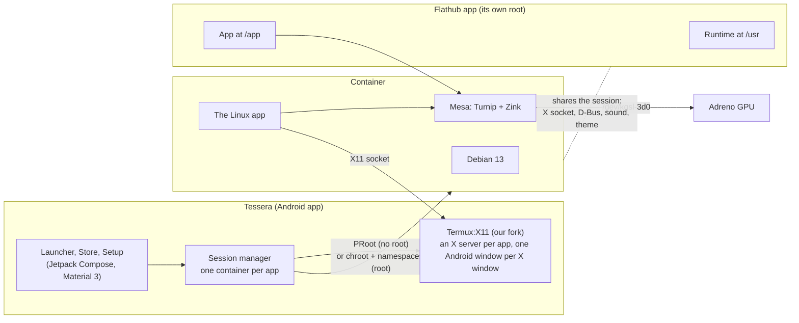

- **Containers:** PRoot is built from source for Android and ships inside the APK; chroot mode
  uses a private mount namespace (and a network namespace when network isn't granted), a minimal
  /dev and an unprivileged user.
- **Display:** each app gets its own X server and display, so apps can't see each other's
  windows. A small window manager keeps the app fullscreen; Tessera follows its windows to give
  each its own Android task.
- **Flathub apps:** Debian's flatpak installs them; Tessera runs them in a root of their own
  (runtime at /usr, app at /app) beside the session's helpers, sharing its X socket, D-Bus and
  sound, with no bubblewrap.
- **Theming:** a per-session theme (adw-gtk3 recolored from Android's Material colors), xsettingsd,
  and a small settings portal on the session bus; rewritten live when Android's colors change.
- **Graphics:** frames from Zink reach the X server as images (Kopper and Vulkan's software
  presentation path), since Android offers no shared-buffer path for them.
- **Permissions** come from per-app manifests ([below](#app-manifests)), changed by the user in
  the app and stored apart from them.

## App manifests

Each launcher entry is a manifest: what to run, and what it may touch.

```json
{
  "id": "gimp",
  "name": "GIMP",
  "category": "Graphics",
  "gui": true,
  "exec": ["/usr/bin/gimp"],
  "permissions": {
    "display": true,
    "network": false,
    "devices": ["/dev/dri/renderD128"],
    "filesystem": [
      { "path": "/storage/emulated/0/Pictures", "mountAt": "/home/user/Pictures", "readOnly": false }
    ]
  }
}
```

Store installs write these for you from each app's desktop file, with permissions that suit its
category. A manifest with `"desktop": true` is a whole desktop instead: its `exec` is the window
manager, and apps opened from its Start menu run inside it (see `apps/desktop.json`).

## Building

JDK 17 and the Android SDK with NDK 29.0.14206865 and CMake 3.31.6.

```
git submodule update --init           # Termux:X11 fork (third_party/termux-x11)
scripts/proot/build.sh                # once: builds PRoot into app/src/main/jniLibs
scripts/x11/build-native.sh           # once, on Linux or WSL: X server + xkb data into build/x11
sudo scripts/gpu/build-mesa.sh        # optional, on Linux or WSL: the GPU driver
sudo scripts/usb/build-usb.sh         # optional, on Linux or WSL: the USB bridge
scripts/theme/build-theme.sh          # optional, anywhere with curl: the GTK theme for Linux apps
./gradlew assembleDebug testDebugUnitTest
```

The native builds need a Linux host (WSL is fine); the app itself builds on Windows, macOS or
Linux. Builds without the optional parts simply lack GPU acceleration or the USB bridge. More on
the native pieces: [docs/native-binaries.md](docs/native-binaries.md).

Debug builds are much slower than releases (Compose runs without its optimizations when an app is
debuggable). To try performance on a phone with a debug build installed, `./gradlew assembleProfile`
builds a release that's signed with the debug key, so it installs over the debug build and keeps its
data.

Release builds (`./gradlew assembleRelease`) are signed with the key in `keystore.properties`
at the top of the project (`storeFile`, `storePassword`, `keyAlias`, `keyPassword`; never
committed), or the `TESSERA_KEYSTORE*` environment variables; without either, with the debug key.
GitHub Actions ([build.yml](.github/workflows/build.yml)) builds everything from source on each
push, and publishes a release for a `v*` tag only when the `TESSERA_KEYSTORE_BASE64`,
`TESSERA_KEYSTORE_PASSWORD`, `TESSERA_KEY_ALIAS` and `TESSERA_KEY_PASSWORD` secrets are set;
otherwise releases are signed and published by hand.

## FAQ

**Do I need root?** No. Everything works in PRoot mode. Root adds chroot mode, which enforces
permissions properly and runs faster.

**Can it replace Termux, AnLinux or Andronix?** For a Linux shell and Linux apps, yes: the Terminal
is a full Debian shell (apt, ssh, git, compilers, servers), PRoot needs no root like AnLinux and
Andronix, and with root you get a real chroot as well. GUI apps open in their own windows instead
of a VNC desktop. What it doesn't have is Termux's own add-ons such as Termux:API.

**Which apps work?** Desktop apps from Debian's catalog, Flathub's arm64 apps, and anything you
install with apt or as a .deb for arm64. Electron apps like VS Code work.

**Flatpak needs bubblewrap. How does Flathub work here?** Flatpak only installs; Tessera runs the
apps itself, building each one's file system (runtime at /usr, app at /app) with PRoot or a mount
namespace instead of bubblewrap. That also means no Flatpak sandbox: Tessera's own per-app
permissions apply instead.

**Why isn't it on Google Play?** Play requires a newer target API level, and those forbid running
programs from app storage, which is what Linux needs. F-Droid has no such rule.

**My apps stop in the background.** Android 12 and newer limit background processes. Setup shows
whether the limit is on, and lifts it in one tap with root, or gives you the adb command.

**An app draws wrong with the GPU on.** Hold its icon, open Look and graphics, and try the fix that
matches what you see, or switch its GPU off.

**An app won't start and I can't tell why.** The error is usually in Android's log, which a
container can't read, so Tessera keeps the output of recently closed apps next to notes on how it
all works. Open the Claude Code shortcut, which reads both, or use Setup → Copy diagnostics and
paste it into any AI. Turn it off in Setup if you'd rather nothing were kept; the files never leave
the phone on their own, and they do name your apps and folders.

## License

Copyright (C) 2026 Daryan Kamaran Karim

This program is free software: you can redistribute it and/or modify it under the terms of the
GNU General Public License as published by the Free Software Foundation, either version 3 of the
License, or (at your option) any later version. See [LICENSE](LICENSE).

It is distributed in the hope that it will be useful, but WITHOUT ANY WARRANTY; without even the
implied warranty of MERCHANTABILITY or FITNESS FOR A PARTICULAR PURPOSE.

### Third-party components

| Component | License | Used for |
|---|---|---|
| [PRoot](https://github.com/termux/proot) (Termux fork) | GPL-2.0-or-later | container engine, built by `scripts/proot/build.sh` |
| [talloc](https://talloc.samba.org) | LGPL-3.0-or-later | PRoot dependency (`scripts/proot/talloc-compat.c` is adapted from Samba) |
| [Termux:X11](https://github.com/termux/termux-x11) ([our fork](https://github.com/daryan044/termux-x11)) | GPL-3.0 | X server and GUI windows |
| [Mesa](https://mesa3d.org) | MIT | GPU driver (Turnip, Zink), built by `scripts/gpu/build-mesa.sh` |
| [libusb](https://libusb.info) | LGPL-2.1-or-later | USB for PRoot apps, built by `scripts/usb/build-usb.sh` |
| [adw-gtk3](https://github.com/lassekongo83/adw-gtk3) | LGPL-2.1 | GTK 3 theme for Linux apps, packed by `scripts/theme/build-theme.sh` |
| [Bibata Cursor](https://github.com/ful1e5/Bibata_Cursor) | GPL-3.0 | the white pointer, packed by `scripts/theme/build-theme.sh` |
| [Flatpak](https://flatpak.org) / [Flathub](https://flathub.org) | LGPL-2.1-or-later / per app | Flathub apps (installed in the container, not shipped) |
| [Termux terminal-emulator / terminal-view](https://github.com/termux/termux-app) | Apache-2.0 | terminal |
| [Haze](https://github.com/chrisbanes/haze) | Apache-2.0 | background blur |
| AndroidX, Jetpack Compose, Material 3 | Apache-2.0 | UI |
| kotlinx.serialization | Apache-2.0 | manifests |
| [XZ for Java](https://tukaani.org/xz/java.html) | 0BSD | reading .tar.xz theme archives |

---

Claude Opus 5.5 was used in the process of creating this app.
